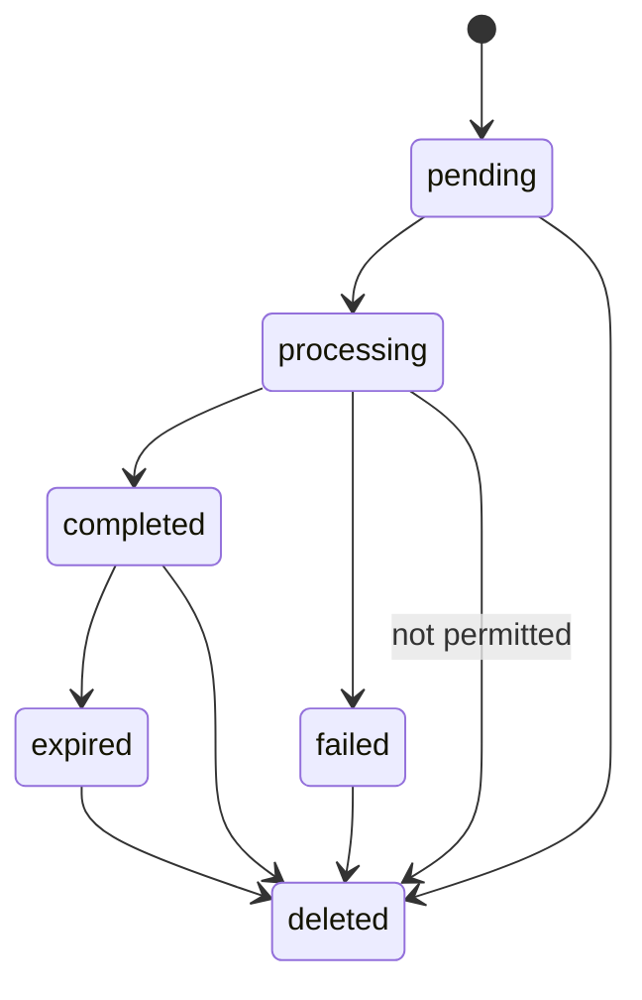

# Architecture Reference

This document expands the system and request flow described in [PROJECT_DOCUMENTATION.md](PROJECT_DOCUMENTATION.md). Source references are relative to the repository root.

## Components and Boundaries

| Component | Responsibility | Source |
|---|---|---|
| React client | Pathname-based page selection, auth context, URL analysis, job polling, history/file UI | `src/App.tsx`, `src/components/UrlDownloader.tsx`, `src/lib/api.ts` |
| FastAPI application | CORS, router mounting, database error handling | `backend/app/main.py` |
| API routers | HTTP validation, auth dependency injection, response construction | `backend/app/api/routes/` |
| Services | User/job lifecycle, media analysis, expiry, storage cleanup | `backend/app/services/` |
| Provider registry | Enabled first-match provider selection | `backend/app/providers/registry.py` |
| Worker | Process pending job, persist progress/state, validate output | `backend/app/workers/download_worker.py` |
| Database | User/job metadata and progress | `backend/app/models/`, `backend/alembic/` |
| Temporary storage | Generated local file paths and permissions | `backend/app/services/storage_service.py` |

## System Architecture

```mermaid
flowchart LR
    Browser[React + TypeScript] -->|HTTP JSON / bearer| API[FastAPI]
    API --> Auth[JWT user dependency]
    API --> Services[Service layer]
    Services --> DB[(PostgreSQL)]
    Services --> Registry[ProviderRegistry]
    Registry --> Direct[DirectFileProvider]
    Registry --> Ytdlp[YtDlpProvider opt-in]
    API --> Queue[FastAPI BackgroundTasks]
    Queue --> Worker[Download worker]
    Worker --> Direct
    Worker --> Ytdlp
    Direct --> Remote[Allowlisted HTTPS MP4]
    Ytdlp --> Remote2[Public HTTP(S) URL via yt-dlp]
    Worker --> Probe[ffprobe validation]
    Ytdlp --> FFmpeg[FFmpeg for stream merge]
    Worker --> Files[(Private local temporary storage)]
    Browser -->|authenticated status/file| API
    API --> Files
```

Media analysis is not inherently an authenticated route. Job creation, history, job detail/status, deletion, and file retrieval are authenticated.

## Download Request Lifecycle

```mermaid
sequenceDiagram
    actor User
    participant UI as React client
    participant API as FastAPI
    participant DB as PostgreSQL
    participant Worker
    participant Provider
    participant Disk as Temporary storage
    User->>UI: Submit URL
    UI->>API: POST /api/media/analyze
    API->>Provider: Registry selection and analyze
    Provider-->>UI: Metadata and offered formats
    User->>UI: Select offered format; acknowledge if required
    UI->>API: POST /api/downloads with bearer token
    API->>DB: Insert pending owner-scoped job
    API-->>UI: 201 pending + job UUID
    API->>Worker: FastAPI BackgroundTask
    Worker->>DB: processing and progress updates
    Worker->>Provider: Analyze and download
    Provider->>Disk: Write generated output
    Worker->>Worker: Size/path/ffprobe/residual checks
    Worker->>DB: completed + expiration or failed + safe error
    loop pending or processing
        UI->>API: GET /api/downloads/{id}/status
        API-->>UI: status and progress fields
    end
    UI->>API: GET /api/downloads/{id}/file + bearer token
    API-->>UI: Authenticated attachment
```

## Provider Selection

```mermaid
flowchart TD
    Input[HTTP(S) URL] --> DirectEnabled{Direct provider enabled?}
    DirectEnabled -->|Yes| DirectMatch{Exact allowlisted HTTPS .mp4?}
    DirectMatch -->|Yes| Direct[DirectFileProvider]
    DirectMatch -->|No| YtdlpEnabled{YtDlp enabled?}
    DirectEnabled -->|No| YtdlpEnabled
    YtdlpEnabled -->|No| Unsupported[UnsupportedPlatform]
    YtdlpEnabled -->|Yes| YtdlpMatch{HTTP(S) hostname and safe public resolution?}
    YtdlpMatch -->|No| Reject[Reject URL/provider]
    YtdlpMatch -->|Yes| Ytdlp[YtDlpProvider]
    Direct --> Analyze[Analyze or download]
    Ytdlp --> Extractor[yt-dlp extraction attempt]
    Extractor -->|recognized and valid output| Analyze
    Extractor -->|unsupported/error| Reject
```

The registry order in `default_provider_registry` is direct then yt-dlp. A match is not a support guarantee: provider analysis may reject a URL or report no supported formats.

## Job State Machine



`deleted` is not a persisted status; it represents row removal. Processing deletion returns `409`. Expiration is observed lazily by status/file endpoints or when `cleanup_temporary_storage()` is called; no scheduler invokes it.

## Deployment Shape

Compose provisions only PostgreSQL. Vite, Uvicorn, migration execution, and the background callback are local processes. No containerized app/worker, external broker, web server/TLS termination, or production topology is defined. The in-process background approach has no durable queue/retry contract and should not be assumed safe for multi-process production scaling.