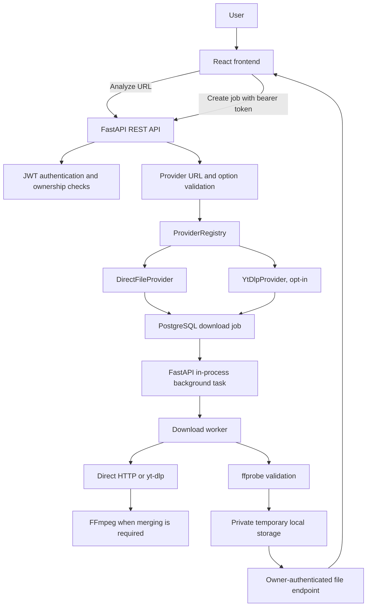
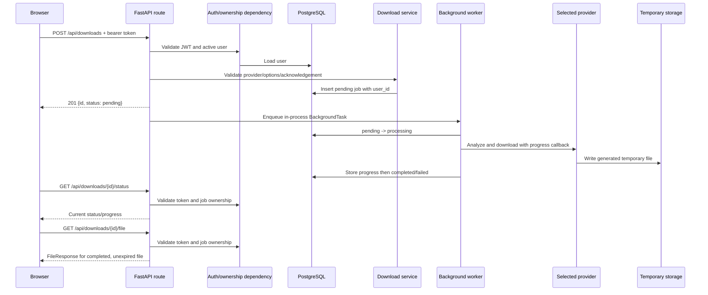
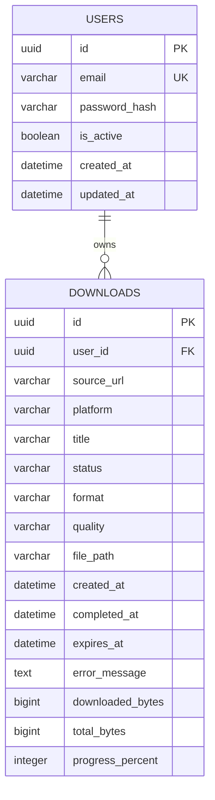
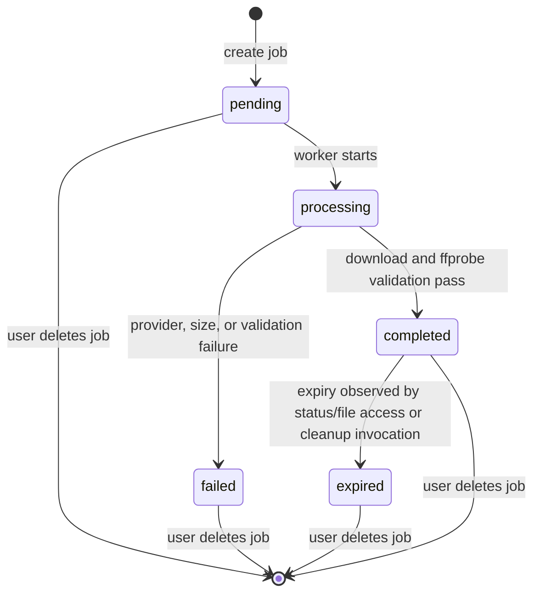

# DownloadIt Project Documentation

## Table of Contents

1. [Project Overview](#1-project-overview)
2. [Technology Stack](#2-technology-stack)
3. [Repository Structure](#3-repository-structure)
4. [Frontend Architecture](#4-frontend-architecture)
5. [Backend Architecture](#5-backend-architecture)
6. [API Documentation](#6-api-documentation)
7. [Authentication](#7-authentication)
8. [Authorization and IDOR Protection](#8-authorization-and-idor-protection)
9. [Database Design](#9-database-design)
10. [Download Job Lifecycle](#10-download-job-lifecycle)
11. [Provider Architecture](#11-provider-architecture)
12. [yt-dlp Integration](#12-yt-dlp-integration)
13. [Quality Selection](#13-quality-selection)
14. [FFmpeg and ffprobe](#14-ffmpeg-and-ffprobe)
15. [File Storage](#15-file-storage)
16. [Security Architecture](#16-security-architecture)
17. [SSRF Protection](#17-ssrf-protection)
18. [Error Handling](#18-error-handling)
19. [Download Progress](#19-download-progress)
20. [History](#20-history)
21. [Configuration](#21-configuration)
22. [Docker and Local Infrastructure](#22-docker-and-local-infrastructure)
23. [Local Development Setup](#23-local-development-setup)
24. [Running Tests](#24-running-tests)
25. [Verified End-to-End Behavior](#25-verified-end-to-end-behavior)
26. [Test Coverage](#26-test-coverage)
27. [Frontend UX](#27-frontend-ux)
28. [Current Limitations](#28-current-limitations)
29. [Production Readiness Assessment](#29-production-readiness-assessment)
30. [Development History](#30-development-history)
31. [Current Project Status](#31-current-project-status)
32. [Recommended Next Phases](#32-recommended-next-phases)

## 1. Project Overview

DownloadIt is a React/TypeScript web client and FastAPI service for analyzing media URLs and preparing temporary, authenticated downloads. It stores account and job metadata in PostgreSQL; media files are stored locally in a private temporary directory. The implemented workflow is URL analysis, user-selected offered format/quality, job creation, background processing, progress polling, and owner-authenticated retrieval.

The current implementation is a functional development-stage application, not a production deployment. Automated backend checks pass, but the repository contains no evidence of a complete live external-media download test. yt-dlp is optional and disabled by the supplied backend example configuration.



The diagram describes the implementation rather than a guarantee that every source will be extractable. The application does not maintain one downloader per platform. yt-dlp is used as a general media extraction/download engine for URLs it legitimately supports, subject to its availability, the configured opt-in, source behavior, and applicable rules.

## 2. Technology Stack

| Area | Verified technology |
|---|---|
| Frontend | React 19, TypeScript 6, Vite 8, Tailwind CSS 4, lucide-react |
| Frontend checks | Oxlint; TypeScript project build via `tsc -b`; Vite production build |
| Backend | Python (no project-declared minimum), FastAPI, Pydantic 2, pydantic-settings, SQLAlchemy 2, Alembic |
| Database | PostgreSQL 17 Alpine in Compose; psycopg 3 driver |
| Media | Optional yt-dlp, FFmpeg executable for stream merging, ffprobe executable for output validation |
| Authentication | PyJWT, `pwdlib[argon2]` recommended password hasher (verified test hashes use Argon2id) |
| Testing | pytest, FastAPI TestClient, SQLite in-memory test database |
| Infrastructure | Docker Compose provisions PostgreSQL only; Vite and Uvicorn are run separately |

Frontend dependency ranges are in [package.json](../package.json) and the lockfile. Backend dependencies are pinned in [requirements.txt](../backend/requirements.txt); optional yt-dlp is pinned separately in [requirements-ytdlp.txt](../backend/requirements-ytdlp.txt). There is no `pyproject.toml` or frontend test script in the inspected repository.

## 3. Repository Structure

```text
.
├── docs/                         # Project and audit documentation
├── public/                       # Vite public assets
├── src/
│   ├── assets/                   # Frontend assets
│   ├── components/               # Landing, navigation, result, and layout UI
│   ├── context/                  # React authentication context/provider
│   ├── lib/                      # API client and session token storage
│   ├── pages/                    # Home, login, registration, history
│   └── types/                    # API response/request TypeScript types
├── backend/
│   ├── alembic/                  # Migration environment and revisions
│   ├── app/
│   │   ├── api/                  # FastAPI dependencies and route modules
│   │   ├── core/                 # Settings, database, network guard
│   │   ├── models/               # SQLAlchemy User and Download models
│   │   ├── providers/            # Provider protocol, registry, implementations
│   │   ├── schemas/              # Pydantic API contracts
│   │   ├── services/             # Auth, jobs, storage, cleanup, analysis
│   │   └── workers/              # Download worker and validation
│   ├── storage/tmp/              # Default private temporary media root
│   ├── tests/                    # Backend tests; external providers are mocked
│   ├── requirements.txt          # Pinned base backend dependencies
│   └── requirements-ytdlp.txt    # Optional yt-dlp dependency
├── docker-compose.yml            # PostgreSQL-only local service
├── package.json                  # Frontend scripts and dependencies
├── .env.example                  # Frontend API base URL example
└── backend/.env.example          # Backend and Compose safe placeholders
```

Generated output, installed dependencies, virtual environments, caches, and local storage contents are intentionally omitted. Notable entry points are [src/main.tsx](../src/main.tsx), [src/App.tsx](../src/App.tsx), [backend/app/main.py](../backend/app/main.py), and [backend/alembic/env.py](../backend/alembic/env.py).

## 4. Frontend Architecture

- `src/main.tsx` mounts `App` under React `StrictMode`. `App.tsx` provides auth context and selects pages using `window.location.pathname`; there is no routing library.
- `/` renders the landing page and URL analyzer. `/login` and `/register` render account forms. `/history` checks auth and redirects unauthenticated users to `/login`.
- `AuthProvider` restores the session by validating the saved token through `/api/auth/me`. Login stores the access token; logout removes it client-side. Registration creates an account but does not automatically sign in.
- `authStorage.ts` uses `sessionStorage` with key `downloadit_access_token`. Authenticated calls attach `Authorization: Bearer ...` in `src/lib/api.ts`.
- URL analysis is anonymous. The client performs basic URL parsing, then calls `POST /api/media/analyze`. The API returns platform and extractor metadata, but the current result component displays the platform label rather than the separate extractor field; only formats returned by the backend are selectable.
- The result selector is populated from `available_formats`, so the UI does not expose arbitrary yt-dlp selectors. yt-dlp results require an explicit authorization checkbox before job creation.
- Job creation, status polling (initial delay about one second, then 1.5-second intervals), completion/error handling, and authenticated file retrieval are in `UrlDownloader.tsx`. The downloaded blob is saved with a generated `DownloadIt-<job-id>` name.
- `History.tsx` fetches the signed-in user's list once per mount, displays title/source/platform/status/format/quality/created time, and offers download for completed records. It does not continuously poll or automatically refresh status.
- State is local React state plus a single context for authentication; there is no global query/store library. TypeScript contracts are in `src/types/`.
- Tailwind responsive classes provide responsive layouts, mobile navigation, and horizontal overflow for the history table. Automated browser/mobile testing is not configured.

Major files: [UrlDownloader.tsx](../src/components/UrlDownloader.tsx), [MockResult.tsx](../src/components/MockResult.tsx) (the name is historical; it renders real analysis responses), [History.tsx](../src/pages/History.tsx), [api.ts](../src/lib/api.ts), [auth-provider.tsx](../src/context/auth-provider.tsx), [download.ts](../src/types/download.ts), and [media.ts](../src/types/media.ts).

## 5. Backend Architecture

`app.main` constructs the FastAPI application, configures CORS, registers exception handling and route modules, and exposes `/`. Configuration comes from Pydantic Settings and `backend/.env`; SQLAlchemy creates a PostgreSQL engine and request-scoped sessions through `get_db`.

Route handlers validate request/response schemas and delegate work to services. Authentication is provided by a bearer-token dependency. Media analysis selects and calls a provider. Download creation persists a pending row and enqueues a FastAPI `BackgroundTasks` callback; the worker reopens a database session, updates status/progress, invokes the selected provider, validates output with ffprobe, and records completion or a sanitized failure. Files are served through a separate authenticated route.



The queue is process-local and not durable. There is no scheduler/startup hook for cleanup. See [ARCHITECTURE.md](ARCHITECTURE.md) for diagrams and boundaries.

## 6. API Documentation

There are **11 `/api` routes** and one root `GET /` route. Swagger UI and ReDoc are exposed by FastAPI at `/docs` and `/redoc` when the server is running.

| Method and route | Auth | Request and response | Behavior and common errors |
|---|---|---|---|
| `GET /` | No | No body; `{service, version}` | Service identity. |
| `GET /api/health` | No | No body; `{status, service, database}` | Performs `SELECT 1`; `503` when DB is unavailable. |
| `POST /api/auth/register` | No | `{email, password}` -> user `{id,email,created_at,is_active}` | Password policy enforced; `201`, `409` duplicate email, `422` invalid data. |
| `POST /api/auth/login` | No | `{email,password}` -> `{access_token,token_type}` | `401` for bad credentials; response uses Bearer token. |
| `GET /api/auth/me` | Bearer | No body -> user object | `401` missing/invalid/expired token or inactive/missing user. |
| `POST /api/media/analyze` | No | `{url}` -> analysis metadata and `available_formats[]` | HTTP(S) syntax is checked; provider errors map to `400`, `422`, or `503`; unexpected errors are sanitized as `502`. |
| `GET /api/downloads` | Bearer | No body -> array of history items | Owner-filtered and newest first. `401` without valid token. |
| `POST /api/downloads` | Bearer | `{source_url,format?,quality?,authorized_to_download?}` -> `{id,status}` | `201` pending; provider options and authorization acknowledgement checked; errors may be `400`, `401`, `422`, `503`. |
| `GET /api/downloads/{download_id}` | Bearer | UUID path -> detail | Owner-scoped; foreign/unknown ID returns `404`; invalid UUID `422`. |
| `GET /api/downloads/{download_id}/status` | Bearer | UUID path -> `{id,status,progress,downloaded_bytes,total_bytes,error}` | Owner-scoped; checks and applies expiration; missing/foreign ID `404`. |
| `GET /api/downloads/{download_id}/file` | Bearer | UUID path -> attachment | Owner-scoped; completed/unexpired only; `404` missing/foreign/file absent, `409` not ready, `410` expired. |
| `DELETE /api/downloads/{download_id}` | Bearer | UUID path -> `{success:true}` | Owner-scoped; processing job `409`; removes completed storage and row; foreign/unknown `404`. |

`MediaAnalyzeResponse` includes `success`, `platform`, `extractor`, `requires_authorization`, optional title/duration/thumbnail/webpage/uploader, and `available_formats`. A format includes output format, quality, extension, resolution, estimated file size, and codec metadata. Download history omits the raw error and storage path; detail adds owner ID, expiration, and error field.

For field-level contracts and response details see [API.md](API.md); schemas are implemented under `backend/app/schemas/` and routes under `backend/app/api/routes/`.

**Existing documentation discrepancy:** `backend/README.md` describes media analysis as authenticated. The current `POST /api/media/analyze` route has no authentication dependency, so analysis is public; job creation, history, status, detail, delete, and file access require a bearer token.

## 7. Authentication

Registration normalizes email and requires at least 12 characters including uppercase, lowercase, a digit, and a symbol. `pwdlib.PasswordHash.recommended()` hashes passwords; tests verify Argon2id-form hashes. Login returns a signed HS256-by-default JWT containing the subject user UUID and expiry. Default/example lifetime is 30 minutes; configuration caps it at 1,440 minutes. `/api/auth/me` validates signature/expiry and reloads an active user from the database.

The frontend stores the bearer token in `sessionStorage`. It is scoped to the tab session and removed at logout, but it remains readable to JavaScript in that origin; an XSS compromise could steal it. There is no refresh-token flow, server-side logout/revocation, or httpOnly-cookie strategy. HTTPS and appropriate production frontend protections remain deployment responsibilities. Logout is client-side token removal.

## 8. Authorization and IDOR Protection

At job creation, `user_id` is set from the authenticated user, not from request data. Read, status, file, delete, and history queries constrain records to that user. A job belonging to another account is returned as `404 Download not found`, intentionally matching a nonexistent ID. This protects job details, history, and files; file retrieval also requires completed/unexpired status and a validated storage-relative path.

```text
User A creates job -> downloads.user_id = A
User B requests job or file -> query matches (job_id AND user_id = B)
No matching row -> 404; file response is not reached
```

This behavior is covered by auth/download tests. See [SECURITY.md](SECURITY.md).

## 9. Database Design

The two tables are `users` and `downloads`. UUID primary keys are generated in application code. `downloads.user_id` references `users.id` with `ON DELETE CASCADE`; ORM relationships also cascade delete-orphan. Download status is constrained to `pending`, `processing`, `completed`, `failed`, or `expired`.



Migration sequence: `0001_initial` creates user/download history; `0002_user_auth` adds password hash/active state, normalizes existing email and adds case-insensitive uniqueness; `0003_download_progress` adds byte counters and percentage. The verified Alembic head is `0003_download_progress`. Schema detail is in [DATABASE.md](DATABASE.md).

## 10. Download Job Lifecycle



Creation validates the selected provider and format/quality, then commits a `pending` row. The worker marks it `processing`, analyzes again, selects a server-side format plan, downloads, checks file/path/size/partial-file conditions, validates media with ffprobe, then marks `completed`. Completed files get `completed_at` and `expires_at`; failures clear the file path and store a generic public error, except selected safe FFmpeg/quality/provider messages. Progress is periodically persisted. `cleanup_temporary_storage()` expires records and removes orphan files, but no scheduled caller is present. Status and file access also perform expiration checks. The history list itself does not.

## 11. Provider Architecture

`MediaProvider` is a structural protocol defining enablement, URL validation, options, analysis, selection, and download. `ProviderRegistry` checks providers in configured order and chooses the first enabled matching provider. The default order is `DirectFileProvider`, then `YtDlpProvider`.

**DirectFileProvider.** Accepts only HTTPS URLs with a path ending `.mp4`, default/443 port, no embedded credentials, and a hostname exactly present in `DOWNLOAD_ALLOWED_HOSTS`. Analysis makes a `HEAD` request; only `video/mp4` is accepted. Both analysis and streaming download reject redirects. Download is streamed in chunks, bounded by `DOWNLOAD_MAX_BYTES`, and does not trust the source filename. Its sole selection is `mp4/source`.

**YtDlpProvider.** Enabled only when `YTDLP_ENABLED=true` and optional yt-dlp is installed. It attempts safe public HTTP(S) URLs using yt-dlp's extractor behavior. Actual extractor/platform data is reported after metadata extraction; the provider does not claim a fixed comprehensive set of platforms. It requires the per-job authorization acknowledgement, disables playlists, accepts no user-supplied yt-dlp options/cookies/credentials/custom headers, and sets yt-dlp's proxy option to empty. Media is limited to generated MP4 or M4A output plans and controlled quality labels. FFmpeg is required for separate stream merging.

**Scope statement:** The application does NOT maintain separate downloader implementations for every platform. It delegates supported media extraction/download to yt-dlp when YtDlpProvider is enabled and yt-dlp legitimately supports the supplied URL. DownloadIt does not promise support for every website or extractor.

## 12. yt-dlp Integration

`YtDlpProvider` imports `YoutubeDL` lazily from the optional package. Analysis invokes `extract_info(url, download=False)` under the public-network DNS guard with quiet logging, `noplaylist`, no cache, empty proxy, bounded timeouts/retries, and no cookie or arbitrary-header options. Playlist/multi-video results are rejected. Extractor key/name is mapped to a lowercase platform label dynamically.

Available formats are derived only from MP4 video streams and M4A audio streams. Server-owned `_YtDlpPlan` objects hold selector strings; the client supplies only format/quality labels. Download config uses a UUID-based output template, `max_filesize`, a progress hook, no overwrite, and yt-dlp partial-file handling. `noplaylist=True` is applied to both analysis and download. When needed, FFmpeg merges compatible separate video/audio streams into MP4. Provider errors are classified and translated to safe messages; raw extractor diagnostics are not returned.

## 13. Quality Selection

The frontend renders exactly the formats returned for the analyzed item. yt-dlp's controlled labels are MP4 `best`, `1080p`, `720p`, `480p`, `360p`, and M4A `audio`, but each is offered only when a compatible format is reported and within the known-size limit. An unlisted request is rejected; a listed choice may still become unavailable between analysis and download. Direct MP4 offers only `mp4/source`. The create-job endpoint receives the requested format/quality but validates it server-side; it does not accept selector expressions.

## 14. FFmpeg and ffprobe

FFmpeg is looked up on `PATH`. yt-dlp uses it only when selected output needs a merge; otherwise a single compatible stream can be downloaded directly. The direct-file provider does not invoke FFmpeg. ffprobe is required for every worker-completed file. It runs with a 15-second timeout and JSON output, checking container and stream types: MP4 must report an `mp4` format token and a video stream; M4A must report an `m4a` token, an audio stream, and no video stream. Missing ffprobe, nonzero exit, malformed output, unexpected container, or missing required stream fails the job. The worker also rejects empty/missing/symlink destination files, over-limit files, and residual sibling files.

## 15. File Storage

Default storage is `backend/storage/tmp` (configurable with `DOWNLOAD_STORAGE_DIR`). Each job receives a UUID directory and a random UUID-like filename with `.mp4` or `.m4a`; database paths are relative. Root/job directories are set to `0700`, completed files to `0600`. Storage resolution rejects absolute paths, `..`, unexpected path depth, invalid generated UUID components/extensions, and paths resolving outside the root. Storage is local and temporary; it is not in PostgreSQL and is not exposed as a static web directory. The file endpoint streams only an authenticated owner's completed and unexpired file. Default maximum file size and lifetime are 50 MiB and 30 minutes.

## 16. Security Architecture

| Threat | Implemented protection | Code location |
|---|---|---|
| Unauthorized account/job access | JWT bearer dependency, active-user lookup, owner-filtered queries | `backend/app/api/dependencies.py`, `services/download_service.py`, route modules |
| Password disclosure | Recommended password hashing; hashes excluded from response schemas | `services/auth_service.py`, `schemas/auth.py` |
| IDOR/file theft | Job queries include both ID and owner ID; file route requires auth | `api/routes/downloads.py`, `services/download_service.py` |
| SSRF to local/private destinations | URL scheme/host/port checks, DNS/IP public-address checks, connection-time DNS guard | `providers/ytdlp_provider.py`, `providers/direct_file.py`, `core/network_security.py` |
| Redirect-to-internal destination | Direct provider disables redirects and rejects 3xx; yt-dlp requests are guarded at connection resolution | Provider implementations |
| Proxy-based destination bypass | yt-dlp gets `proxy=''`; direct provider uses default httpx `trust_env` behavior (see SSRF caveat) | Provider implementations |
| Resource exhaustion via large media | Advertised-size filtering, yt-dlp max file size, streaming/progress/final size checks | Provider modules, worker |
| Arbitrary output path/name | Generated job/file UUIDs, restricted extensions, containment checks | `services/storage_service.py` |
| Partial/misleading output | Symlink/empty/residual-file checks and ffprobe container/stream verification | `workers/download_worker.py` |
| Error detail disclosure | Provider mapping, generic worker failure, safe DB exception handler | `providers/errors.py`, `workers/download_worker.py`, `app/main.py` |
| Unauthorized extractor options or playlist processing | Controlled selector mapping, no client yt-dlp options, `noplaylist=True` | `providers/ytdlp_provider.py` |
| Stale media retention | Expiry timestamp, lazy expiry on status/file access, explicit cleanup service | `services/download_service.py`, `services/storage_cleanup.py` |

No DRM bypass, authentication bypass, cookie/session acquisition, CAPTCHA bypass, rate-limit bypass, or private-content extraction is implemented or recommended. The explicit authorization checkbox is user acknowledgement, not a rights verification mechanism.

## 17. SSRF Protection

For yt-dlp URLs the sequence is: parse HTTP(S), reject credentials/local suffixes/disallowed ports, reject invalid host forms, resolve all returned addresses, require every address to be global, and reject playlist paths. The request then runs inside `public_network_dns_guard()`, which checks every `socket.getaddrinfo` result during the guarded operation and rejects any non-global address. The guard is applied around yt-dlp analysis/download and direct HTTP calls; direct URLs are additionally constrained to exact host allowlist and HTTPS.

Checking only before a request can be insufficient because DNS can change between validation and connection. The connection-time guard narrows that DNS-rebinding window by checking resolution at lookup time too. Direct provider has redirects disabled. yt-dlp may follow extractor-managed URLs, with guarded socket resolution. yt-dlp explicitly disables proxy use. In contrast, `httpx.Client` for direct MP4 does not set `trust_env=False`; its default may honor environment proxy variables. The DNS guard does not independently establish the destination used by an external proxy, so deployments must account for proxy environment configuration. This is an implementation limitation, not a claim that proxy-mediated DNS is guarded.

Only yt-dlp rejects all private/non-global resolutions generically. Direct provider's exact host allowlist and guarded resolution are its controls. HTTP is accepted for yt-dlp but not the direct-file provider.

## 18. Error Handling

Provider exceptions map to stable public messages: malformed URL `422`; unsupported source and unsuitable content generally `400`; unavailable provider/FFmpeg `503`; unavailable quality `400`; processing/analysis fallback `502`. Authentication errors use `401`; foreign/missing jobs use `404`; pending/processing file retrieval uses `409`; expired file retrieval uses `410`. Worker errors persist generic text, with selected safe messages for missing FFmpeg, unavailable quality, and temporary provider failure. SQLAlchemy errors become `503` without exposing exception details. Frontend API helpers extract safe `detail` values where provided and otherwise use generic connection/service messages.

## 19. Download Progress

The `downloads` table stores nullable `downloaded_bytes`, `total_bytes`, and `progress_percent`. Provider callbacks report bytes and optional total. The worker refuses progress past the maximum and persists updates no more than once per second (plus the first report). Percentage is integer `downloaded * 100 / total`, capped at 100; it stays null without a positive total. Completion sets byte fields to final size and progress to 100. `GET .../status` returns these fields. The frontend polls while status is pending/processing and displays percentage/byte counts when known; failed/completed/expired stop polling.

## 20. History

History rows are stored per user and queried newest-first. The UI displays title (or fallback), source URL, platform label, status, output format, quality, and creation time. Completed rows expose the authenticated file action; pending/processing and terminal states are labeled. The list does not expose backend error details or expiration timestamp. It does not poll status. Since lazy expiry is applied by status/file access and the cleanup service is not scheduled, a history row can continue to appear completed after its file lifetime until one of those paths observes expiration.

## 21. Configuration

| Variable | Required? | Default/example | Purpose | Sensitive? |
|---|---|---|---|---|
| `DATABASE_URL` | Yes | Example uses local PostgreSQL URL | SQLAlchemy connection; must match Compose credentials/host | Yes |
| `JWT_SECRET_KEY` | Yes | Safe placeholder in example | HMAC signing key | Yes |
| `JWT_ALGORITHM` | No | `HS256` | JWT signing/verification algorithm | No |
| `ACCESS_TOKEN_EXPIRE_MINUTES` | No | `30` | Token lifetime, range 1–1440 | No |
| `APP_ENV` | No | `development` | Settings value; no behavior switch was found | No |
| `APP_NAME` | No | `DownloadIt API` | Service identity | No |
| `APP_VERSION` | No | `1.0.0` | Service version | No |
| `FRONTEND_URL` | No | `http://localhost:5173` | CORS configured origin | No |
| `DOWNLOAD_ALLOWED_HOSTS` | No | Example: `samplelib.com` | Exact host allowlist for direct MP4 | No |
| `DOWNLOAD_FILE_EXPIRATION_MINUTES` | No | `30` | Completed media lifetime, range 1–10080 | No |
| `DOWNLOAD_MAX_BYTES` | No | `52428800` | Media cap in bytes (50 MiB default) | No |
| `DOWNLOAD_STORAGE_DIR` | No | `backend/storage/tmp` | Local temporary storage root | No |
| `YTDLP_ENABLED` | No | `false` | Opt in to generic yt-dlp provider | No |
| `POSTGRES_DB` | Compose-required | Example: `downloadit` | PostgreSQL container database name | No |
| `POSTGRES_USER` | Compose-required | Example: `downloadit` | PostgreSQL container user | Yes |
| `POSTGRES_PASSWORD` | Compose-required | Replace placeholder locally | PostgreSQL container password | Yes |
| `VITE_API_BASE_URL` | No | `http://localhost:8000` | Frontend API origin | No |

Backend settings read `backend/.env`; only the values in `.env.example` are safe templates. `POSTGRES_*` must be explicitly present for Compose and credentials must be consistent with `DATABASE_URL`. `APP_ENV` is defined but no runtime mode behavior was observed. Do not put production secrets in committed example files.

## 22. Docker and Local Infrastructure

`docker-compose.yml` defines one `postgres:17-alpine` service. It publishes only on loopback (`127.0.0.1:5432`), stores database files in named volume `downloadit-postgres-data`, restarts unless stopped, and checks readiness with `pg_isready`. Compose requires `POSTGRES_DB`, `POSTGRES_USER`, and `POSTGRES_PASSWORD`; use `docker compose --env-file backend/.env up -d`. It does not define frontend, backend, worker, or migration containers and has no application dependency/startup ordering. Apply migrations and start API/UI separately.

## 23. Local Development Setup

Prerequisites: macOS, Node.js/npm compatible with Vite 8, Python with venv/pip, Docker Desktop or local PostgreSQL, and (for media validation) FFmpeg/ffprobe. Vite 8's supported Node floor should be confirmed against the installed runtime before deployment; no `.nvmrc` is present.

```bash
# From the repository root
cp backend/.env.example backend/.env
# Edit backend/.env: set a strong random JWT_SECRET_KEY and matching local DB values.
cp .env.example .env

brew install ffmpeg
docker compose --env-file backend/.env up -d

cd backend
python3 -m venv .venv
source .venv/bin/activate
pip install -r requirements.txt
# Optional only when authorized/permitted yt-dlp testing is needed:
pip install -r requirements-ytdlp.txt
alembic upgrade head
uvicorn app.main:app --reload --host 0.0.0.0 --port 8000
```

Run the frontend in a second terminal from the repository root:

```bash
npm install
npm run dev
```

Open the Vite URL (normally `http://localhost:5173`). Set `YTDLP_ENABLED=true` only after installing the optional dependency and reviewing the legal/security scope. The backend example defaults to `false`. Never reuse placeholder JWT/database credentials outside local development. Detailed instructions are in [SETUP.md](SETUP.md).

## 24. Running Tests

```bash
cd backend
source .venv/bin/activate
pytest
pytest tests/test_ytdlp_provider.py
```

Frontend commands from repository root:

```bash
npm run lint
npm run build
```

There is no frontend unit/e2e test script. Backend tests use in-memory SQLite, replace the queue with a no-op, and mock external provider/network behavior. They verify contracts and security logic, but do not prove current live extractor/site behavior. Current validation during this documentation task: **92 passed**, one Starlette TestClient deprecation warning; frontend lint completed cleanly; frontend build succeeded; Alembic reports `0003_download_progress` as head. See [TESTING.md](TESTING.md).

## 25. Verified End-to-End Behavior

**Repository evidence:** unit/integration tests cover account registration/login, authenticated job creation/history/status, separate worker processing, fake-provider progress, output validation (with mocked ffprobe), authenticated owner file access, and cleanup invocation. Provider and yt-dlp tests use fake HTTP clients/FakeYoutubeDL and mocked DNS. URLs that resemble public sample, Instagram, and YouTube URLs are fixture inputs, not proof of requests to those sites.

**Live-tested:** no repository artifact, test report, or source evidence was found demonstrating a real external media analysis-to-download flow. During this documentation task, no live external media was requested or downloaded. Do not treat the fixture URLs as historical live-test evidence. The application can only claim the behavior covered by its source and automated tests, not current site availability.

## 26. Test Coverage

The 92 backend tests cover authentication and token validation; ownership/IDOR and API history; health/database error handling; URL validation and provider selection; direct-provider MIME/redirect/error behavior; yt-dlp enablement, metadata mapping, playlist rejection, public/private address checks, controlled quality, size limit, progress, and error mapping; worker state/progress/size/failure; ffprobe validation; storage path constraints; file access/expiry; and cleanup logic. Test files: `test_auth.py`, `test_downloads.py`, `test_health.py`, `test_providers.py`, `test_ytdlp_provider.py`, and `test_download_worker.py`.

Gaps: live upstream integration, frontend automated tests, browser/mobile accessibility checks, multi-process queue behavior, actual PostgreSQL migration application in the test suite, and an automatically scheduled cleanup path are not verified by this test suite.

## 27. Frontend UX

Current screens include a landing page with URL input and feature copy, analysis/loading/error states, metadata preview, detected platform label (not the separate extractor field), duration/uploader, available quality selector, authorization acknowledgement when required, job progress/completed/failure/expired states, login/register, responsive navigation, and a history table. No separate “platform catalog” is guaranteed; the provider strip currently lists Direct MP4 only.

Some visible polish/product elements are placeholders: navigation items for Features/Platforms/Pricing and footer Privacy/Terms use `href="#"`; the features section contains broad marketing claims not enforced as service-level guarantees. The result component's `MockResult` name is misleading but it consumes API results. These are documented as incomplete, not silently represented as implemented workflows.

## 28. Current Limitations

- No claim that every website is supported; yt-dlp extractor compatibility and source policies change.
- yt-dlp is optional and example-disabled; direct MP4 is restricted to exact allowlisted hosts.
- Playlists are rejected. Authentication-required/private content is not bypassed. DRM/access controls are not bypassed.
- Default file cap is 50 MiB; storage is local and ephemeral, not shared/object storage.
- Queue is FastAPI in-process `BackgroundTasks`, without durable retries, external queue, or worker coordination.
- Cleanup is implemented as a service but is not automatically scheduled; history may remain stale until expiry is observed.
- Session token in `sessionStorage` is accessible to same-origin JavaScript; no refresh or revocation mechanism exists.
- Direct provider's httpx client may honor proxy environment variables; yt-dlp disables proxies. Proxy-mediated resolution is not independently guarded by the DNS wrapper.
- Existing backend README calls media analysis authenticated, but the current analysis route is public. Its no-proxy wording applies to yt-dlp options, not the default httpx behavior of DirectFileProvider. The ignored local `.env` was not inspected, so its actual yt-dlp enablement was not verified.
- No rate limiting, production deployment manifests, monitoring, backups, or structured production logging were found.
- Frontend pages and components have no automated test suite; placeholders remain in navigation/footer.

## 29. Production Readiness Assessment

| Area | Current state | Production ready? | Remaining work |
|---|---|---:|---|
| Frontend | Working Vite app; lint/build pass | Partial | Real UX/accessibility/browser review; replace placeholder links; add tests. |
| Backend/API | FastAPI routes/services present | Partial | Deployment config, operational hardening, rate limits, observability. |
| Database | PostgreSQL schema/migrations present | Partial | Production provisioning, backup/restore, migration operations. |
| Authentication | Argon2id-style hashing, short JWT | Partial | Secure production token lifecycle/storage and abuse controls. |
| Authorization | Owner filters on job/file operations | Yes for implemented endpoints | Retain regression tests; audit any new routes. |
| Downloader | Direct HTTP and optional yt-dlp | Partial | Authorized live source validation, operational limits, durable execution. |
| Storage | Private local temp files and containment | Partial | Shared/durable storage policy, automated cleanup, capacity monitoring. |
| SSRF | Public resolution checks and connection guard | Partial | Resolve proxy caveat; deployment-specific egress controls and review. |
| Secrets | SecretStr and ignored env files | Partial | Managed secret injection/rotation; ensure no placeholder deployment. |
| CORS | Configured origin plus local development origins/regex | No for production unchanged | Narrow allowed origins/methods/headers for deployed environment. |
| Rate limiting | Not implemented | No | Add abuse controls before public exposure. |
| Logging/monitoring | No application observability stack found | No | Structured logs, metrics, tracing, alerting. |
| Job queue/concurrency | In-process FastAPI background task | No | Durable queue, worker isolation, retries/idempotency. |
| Deployment/HTTPS | No app deployment configuration found | No | TLS termination, hardened deployment, secret/egress controls. |
| Backups | Not configured | No | Database/storage backup and recovery procedures. |
| Cleanup | Expiry and callable cleanup service | Partial | Schedule cleanup and monitor failures/storage use. |

## 30. Development History

No `.git` metadata or commit history is present in the supplied workspace. The three Alembic revisions establish only this schema sequence: initial users/download history (`0001_initial`), authentication fields and normalized email uniqueness (`0002_user_auth`), then progress counters (`0003_download_progress`). Current source proves that direct provider, auth, provider registry, optional yt-dlp, progress, media validation, DNS guard, storage cleanup, and tests exist, but does not establish when or in which numbered product phase they were added.

**Exact implementation history could not be fully reconstructed from repository evidence.** Phases 1–12 cannot be truthfully assigned beyond the migration sequence above. Historical live validation of Instagram/YouTube or other providers was not evidenced in repository artifacts inspected for this audit.

## 31. Current Project Status

| Area | Status | Evidence |
|---|---|---|
| Frontend | PARTIAL | Pages/components implemented; placeholders and no frontend test suite. |
| Backend | COMPLETE for current local API scope | Routes/services implemented; operational production features absent. |
| Database | COMPLETE for current schema | Two tables, three migrations, current head verified. |
| Authentication | COMPLETE for basic account/JWT flow | Registration/login/me and tests; production token caveats remain. |
| Downloader | PARTIAL | Direct file and optional yt-dlp providers; no live E2E evidence. |
| Providers | COMPLETE for two current implementations | DirectFileProvider and YtDlpProvider; latter opt-in. |
| Media validation | COMPLETE in worker path | ffprobe required, size/container/stream/residual checks tested. |
| Security | PARTIAL | Ownership, JWT, URL/DNS/storage controls exist; gaps in production hardening. |
| Testing | COMPLETE for configured backend validation | 92 passed; tests are mostly isolated/mocked. |
| Infrastructure | PARTIAL | Compose runs PostgreSQL only. |
| Documentation | COMPLETE after this documentation set | Master plus focused references and audit report. |
| Deployment readiness | NOT STARTED | No production deployment configuration/operational stack found. |

yt-dlp is **OPTIONAL/DISABLED** by the provided example. Automated tests are **TESTED**; live external integration is **NOT VERIFIED**. Cleanup is implemented but automatic scheduling is **NOT IMPLEMENTED**.

## 32. Recommended Next Phases

**Phase 13: UI/UX polish and real-user testing.** Resolve placeholder navigation/footer links, review claims against service behavior, add browser/mobile/accessibility checks, and evaluate sign-in-to-download ergonomics.

**Phase 14: Production deployment and hardening.** Design a durable queue/worker, scheduled cleanup, rate limits, production token strategy, deployment-managed secrets, narrow CORS, HTTPS/egress policy, logging/monitoring, storage capacity/retention, and database backups. Validate only sources the operator and user are authorized to use. These are recommendations only; no implementation changes were made.

Further detail: [PRODUCTION_READINESS.md](PRODUCTION_READINESS.md).