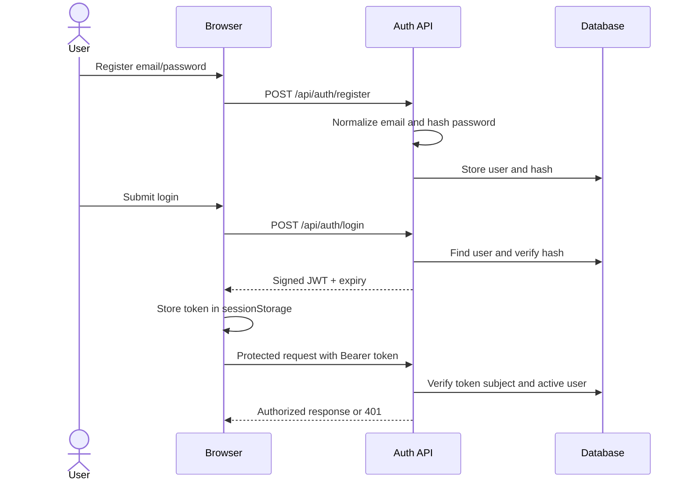
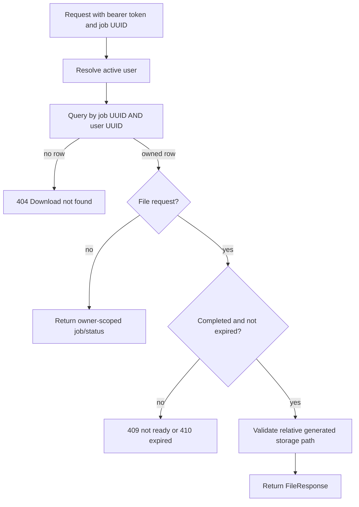
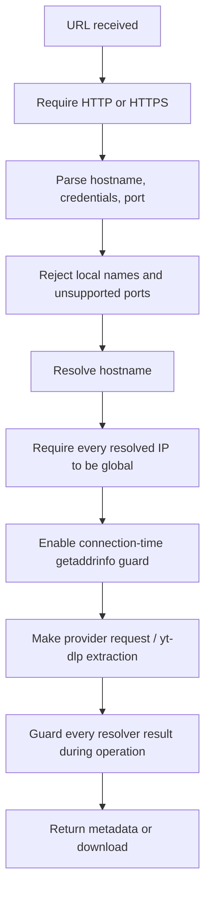

# Security Reference

Security controls documented here are present in source; they do not substitute for deployment review. See the [master security overview](PROJECT_DOCUMENTATION.md#16-security-architecture).

## Authentication Flow

Passwords use `pwdlib.PasswordHash.recommended()`; current tests confirm Argon2id-format output. JWT subject is a user UUID, expiration is enforced, and `JWT_SECRET_KEY` is loaded as `SecretStr`. The default algorithm is HS256. Frontend `sessionStorage` is JavaScript-readable, so XSS can expose a live token. Logout removes the browser value only; there is no server-side revocation/refresh endpoint.

## Ownership and File Authorization

History is filtered by `user_id`. Job detail, status, delete, and file routes call `get_download_for_user`. Foreign and nonexistent IDs share `404`, preventing direct object reference enumeration from disclosing ownership. Tests cover cross-user job read/delete and completed-file access.

## SSRF Validation

`YtDlpProvider.validate_url()` resolves names and rejects non-global IPs; a `ContextVar`-scoped wrapper around `socket.getaddrinfo` repeats address classification during network activity. URL credentials are rejected; yt-dlp permits only default HTTP/HTTPS ports and rejects local suffixes and `/playlist`. The direct provider is additionally limited to exact allowlisted HTTPS hosts and `.mp4`, and disables redirects for both `HEAD` and `GET`.

**Proxy caveat:** yt-dlp receives `proxy=''`. Direct-file requests use `httpx.Client` without setting `trust_env=False`, so environment proxy variables may affect routing. The DNS guard cannot independently validate a destination resolved by an external proxy. This should be included in deployment SSRF/egress review.

## Additional Controls

| Risk | Control | Relevant implementation |
|---|---|---|
| Arbitrary selectors/options | Format/quality allowlist maps to server-owned selector plans; no user yt-dlp options | `../backend/app/providers/ytdlp_provider.py` |
| Playlist expansion | `noplaylist=True`; reject playlist/multi-video results | Same provider |
| Oversized source | Metadata filtering, provider size cap, worker progress/final checks | Providers and `../backend/app/workers/download_worker.py` |
| Path traversal | Relative path shape/UUID/extension validation and resolved containment | `../backend/app/services/storage_service.py` |
| Unsafe output file | UUID naming, `0700` directories, `0600` file, symlink/empty/residual checks | Storage service and worker |
| Invalid media | ffprobe container/stream validation with 15-second timeout | Worker |
| Upstream/DB detail leaks | Provider error mapping, generic job error, generic SQLAlchemy 503 | `../backend/app/providers/errors.py`, `../backend/app/main.py` |
| Retained files | Expiration timestamp, lazy expiry, callable orphan cleanup | `../backend/app/services/download_service.py`, `storage_cleanup.py` |

## Security Boundaries and Gaps

- HTTPS is mandatory for direct MP4; yt-dlp accepts HTTP or HTTPS public URLs.
- No cookies, credentials, custom HTTP headers, or arbitrary yt-dlp options are provided. yt-dlp proxy is disabled. The app does not bypass DRM, login/access requirements, CAPTCHA, or rate limits.
- Per-job acknowledgement is self-attestation, not authorization verification.
- There is no rate limiting, CSRF-sensitive cookie flow (bearer token is used), production CSP/deployment config, monitoring, or scheduled cleanup defined here.
- CORS includes configured frontend origin and development localhost patterns; narrow this for production.
- Local temp storage and process-local queue impose deployment constraints.